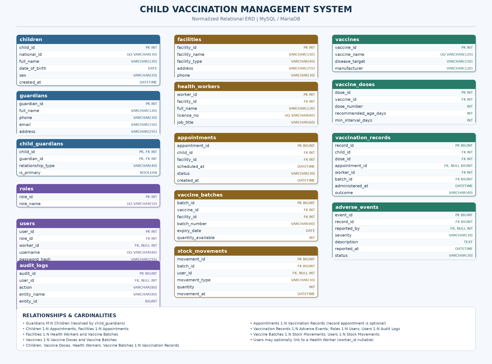

# Child Vaccination Management System

A real-world-oriented Database Management System (DBMS) case study developed using **MySQL / MariaDB**. This project models the management of child vaccination records, guardians, healthcare facilities, vaccine schedules, appointments, vaccine inventory, administered doses, and adverse-event reports.

The objective is to apply core and advanced database concepts to practical healthcare management scenarios while maintaining data integrity, minimizing redundancy, and supporting reliable reporting.

## Project Objectives

- Design a normalized relational database for child vaccination management.
- Maintain child, guardian, healthcare worker, and facility information.
- Manage vaccine types, recommended doses, batch details, and expiry dates.
- Schedule appointments and record administered vaccinations.
- Track vaccine stock movements and inventory usage.
- Record and review reported adverse events.
- Generate vaccination history, coverage summaries, overdue-dose reports, and inventory reports.
- Apply transactions to maintain consistency during vaccination and stock updates.
- Demonstrate triggers, stored procedures, views, indexing, hashing, partitioning, and database access control.
- Validate the database using practical SQL queries and testing scenarios.

## Technologies Used

- **Database:** MySQL / MariaDB
- **Query Language:** SQL
- **Database Environment:** XAMPP and phpMyAdmin, or another compatible client
- **Storage Engine:** InnoDB
- **Documentation:** Markdown
- **Diagram:** Entity–Relationship Diagram (ERD)

## Real-World Problems Addressed

This case study is designed to answer practical healthcare-management questions, including:

- Which vaccines has a child received?
- Which children have incomplete vaccination schedules?
- Which doses are due or overdue according to the configured schedule?
- Which appointments are scheduled, completed, cancelled, or missed?
- How many doses were administered by each facility during a period?
- Which vaccine batches are approaching expiry?
- How much usable stock is available at each facility?
- Which stock movements occurred during a vaccination transaction?
- Which adverse events have been reported and what is their review status?
- Which healthcare workers administered particular doses?
- How can duplicate vaccination records and inconsistent inventory updates be prevented?

**Important:** Dose timing and overdue status must be based on a verified vaccination schedule and the configured rules. The sample project is an educational database, not a clinical decision-making system.

## Entity–Relationship Diagram (ERD)

The proposed database includes the following major entities:

- **Children and Guardians:** Child records and guardian relationships.
- **Facilities and Health Workers:** Healthcare locations and staff.
- **Vaccines and Vaccine Doses:** Vaccine catalogue and dose schedules.
- **Appointments and Vaccination Records:** Scheduled visits and administered doses.
- **Vaccine Batches and Stock Movements:** Inventory tracking and stock history.
- **Adverse Events:** Reports associated with vaccination records.
- **Users, Roles, and Audit Logs:** Access control and activity tracking.

The ERD represents the planned relational design. The final schema and constraints will be validated against the SQL implementation as the project develops.

## How to Run the Project

1. Install or open a MySQL / MariaDB environment.
2. Start the database server and open phpMyAdmin or another SQL client.
3. Execute `01_schema.sql` to create the database and tables.
4. Execute `02_sample_data.sql` to insert demonstration records.
5. Run the remaining SQL files in numerical order, following the instructions in each file.
6. Review the result sets and verify the expected behavior.
7. Use separate database sessions for experiments that require concurrent transactions.
8. Review the ERD and this README to understand the overall design.

**Important:** Some files create database objects, modify records, or require elevated privileges. Review destructive operations before running them. Use a development database for practice, and never place real children's personal or medical data in a public repository.

## Compatibility Notes

- SQL syntax and feature availability vary by MySQL / MariaDB version.
- MySQL does not provide native materialized views in the same way as some other database systems; summary tables and refresh procedures can be used instead.
- Partitioned InnoDB tables have foreign-key restrictions. Partitioning will therefore be designed and tested separately from the main foreign-key-heavy schema where necessary.
- Hashing demonstrations must not store plaintext passwords. Password authentication should use an appropriate password-hashing algorithm and application-level verification.
- Sample vaccine schedules and data are illustrative and must not be treated as medical guidance.

## Learning Outcomes

By completing this case study, learners can practice:

- Designing normalized relational databases.
- Writing SQL queries for real-world reporting and analysis.
- Enforcing data integrity through constraints and relationships.
- Applying transactions to multi-step operations.
- Understanding indexing, query plans, and partitioning.
- Automating database workflows with triggers and stored procedures.
- Applying database permissions and security principles.
- Testing and documenting a multi-table database project.

## Project Status

**Status:** In development.

The project will be completed incrementally, with each SQL file implemented and tested before moving to the next stage. Final completion will depend on verifying the schema, sample data, reports, transaction workflows, and database objects.

---
