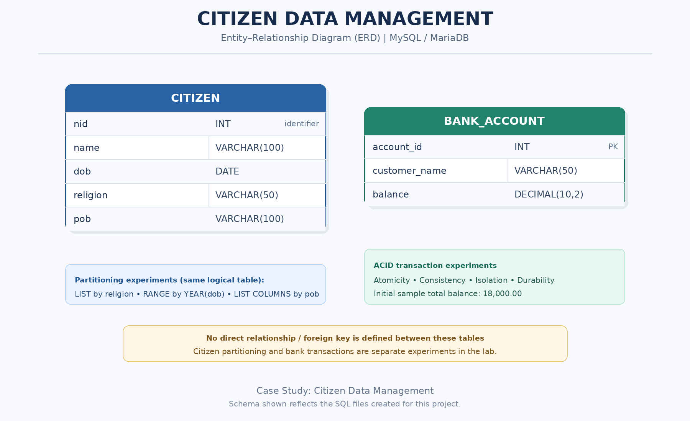

# Citizen Data Management

A practical Database Management System (DBMS) case study using **MySQL / MariaDB**. This project explores citizen data partitioning and bank transaction management, with a primary focus on the concepts and experiments covered in the provided Lab 9 PDF.

The project combines practical SQL implementation, partition analysis, query execution plans, and transaction experiments to demonstrate how database systems organize data and maintain reliable financial records.

## Reference Material

The original PDF for this case study is available below.

- 📄 [Citizen Data Management.pdf](Citizen%20Data%20Management.pdf)

This document serves as the primary reference for the case study, including its requirements, practical exercises, and database experiments.

## Project Objectives

- Implement table partitioning using `LIST`, `RANGE`, and `LIST COLUMNS`.
- Organize citizen records according to religion, date of birth, and place of birth.
- Inspect partition definitions and verify data distribution.
- Analyze queries using `EXPLAIN` and partition-aware execution plans.
- Implement bank account transactions using MySQL's InnoDB storage engine.
- Demonstrate the four ACID properties: Atomicity, Consistency, Isolation, and Durability.
- Verify database records, table structures, partition definitions, and transaction results.
- Develop practical SQL skills through a structured, real-world-oriented case study.

## Technologies Used

- **Database:** MySQL / MariaDB
- **Query Language:** SQL
- **Database Environment:** XAMPP and phpMyAdmin
- **Storage Engine:** InnoDB
- **Documentation:** Markdown
- **Source Material:** Lab 9 PDF — Table Partitioning and ACID Compliance

## Entity–Relationship Diagram (ERD)

## SQL Files and Their Purposes

| File | Description |
|---|---|
| `01_list_partitioning.sql` | Creates citizen records partitioned by religion using LIST COLUMNS. |
| `02_range_partitioning.sql` | Partitions citizen records by birth year into seven generation-based ranges. |
| `03_pob_partitioning.sql` | Implements place-of-birth partitioning using LIST COLUMNS. |
| `04_bank_account_setup.sql` | Creates the bank account table and inserts the initial account records. |
| `05_atomicity.sql` | Demonstrates transaction updates, COMMIT, and ROLLBACK. |
| `06_consistency.sql` | Checks account balances and total balance before and after a transfer. |
| `07_isolation.sql` | Examines concurrent transactions using two separate database sessions. |
| `08_durability.sql` | Tests committed data persistence and the behavior of uncommitted changes. |
| `09_final_verification.sql` | Verifies citizen records, partition metadata, and bank account balances. |

## Major Topic 1: Database Table Partitioning

Partitioning divides a large logical table into smaller physical partitions while retaining a single logical table for queries.

### 1. LIST Partitioning

**File:** `01_list_partitioning.sql`

Citizen records are distributed according to their religion.

The implementation includes five partitions:

- Islam
- Hinduism
- Buddhism
- Christianity
- Other

The file creates the citizen table, inserts sample records, inspects partition metadata, and counts the records stored in each partition.

### 2. RANGE Partitioning

**File:** `02_range_partitioning.sql`

Citizen records are distributed according to `YEAR(dob)`.

The seven partitions represent:

- Silent Generation
- Baby Boomers
- Generation X
- Millennials
- Generation Z
- Generation Alpha
- Generation Beta

The file demonstrates range boundaries, partition distribution, Generation Z record counting, and query execution-plan analysis.

### 3. Place-of-Birth Partitioning

**File:** `03_pob_partitioning.sql`

This implementation uses `LIST COLUMNS(pob)` to distribute records according to their place of birth.

The sample partitions are:

- Dhaka
- Khulna
- Rajshahi
- Chattogram

The file also demonstrates partition-specific queries, grouped citizen counts, partition metadata inspection, and execution-plan analysis.

**Important:** The three partitioning files recreate the same `citizen` table with different partitioning strategies. Only the most recently executed version remains active under that table name.

## Major Topic 2: ACID Transaction Management

ACID represents four properties that help ensure reliable database transactions.

### 1. Atomicity

**File:** `05_atomicity.sql`

Atomicity means a transaction's changes are treated as a single unit of work.

The experiment demonstrates:

- Deducting money from one account.
- Adding money to another account.
- Committing a successful transaction.
- Rolling back an uncommitted transaction.

### 2. Consistency

**File:** `06_consistency.sql`

Consistency means transactions should preserve the database's defined rules and invariants.

The experiment checks:

- Individual account balances.
- The total balance before a transfer.
- The total balance after a transfer.
- Whether the total balance remains consistent.

### 3. Isolation

**File:** `07_isolation.sql`

Isolation concerns how concurrent transactions interact.

The experiment uses two separate MySQL sessions to examine:

- Transaction visibility.
- Uncommitted updates.
- Concurrent account updates.
- Locking and possible deadlocks.
- Transaction completion and final balance verification.

The exact behavior depends on transaction timing, isolation level, and server configuration.

### 4. Durability

**File:** `08_durability.sql`

Durability means successfully committed changes persist after a normal database restart.

The experiment distinguishes between:

- Uncommitted changes that should be rolled back when their connection terminates.
- Committed changes that should persist after a normal restart.
- Balance verification before and after the restart.

The restart experiment should only be performed in a local practice environment.

## Database Design

### Citizen Table

The citizen table contains the following attributes:

| Attribute | Data Type | Purpose |
|---|---|---|
| `nid` | `INT` | Citizen identification number |
| `name` | `VARCHAR(100)` | Citizen name |
| `dob` | `DATE` | Date of birth |
| `religion` | `VARCHAR(50)` | Religion category |
| `pob` | `VARCHAR(100)` | Place of birth |

### Bank Account Table

| Attribute | Data Type | Purpose |
|---|---|---|
| `account_id` | `INT` | Account identifier and primary key |
| `customer_name` | `VARCHAR(50)` | Account holder's name |
| `balance` | `DECIMAL(10,2)` | Current account balance |

The initial sample data contains two bank accounts with balances of 10,000.00 and 8,000.00, giving an initial total balance of 18,000.00.

## How to Run the Project

1. Install XAMPP or use an available MySQL/MariaDB environment.
2. Start the database server and open phpMyAdmin.
3. Create or select the `citizen_data_management` database.
4. Execute `01_list_partitioning.sql` and inspect the results.
5. Execute `02_range_partitioning.sql` to explore RANGE partitioning.
6. Execute `03_pob_partitioning.sql` to explore POB partitioning.
7. Execute `04_bank_account_setup.sql` to create the bank account table.
8. Execute the transaction experiments in the appropriate order.
9. For the Isolation experiment, use two separate database sessions.
10. For the Durability experiment, follow the restart instructions in a local development environment.
11. Execute `09_final_verification.sql` to inspect the final database state.

**Important:** The citizen partitioning scripts drop and recreate the `citizen` table. Run them individually and retain separate versions under different table names if you need to compare all three partitioning strategies simultaneously.

The transaction scripts modify account balances. Review the current balances before rerunning them to avoid applying sample transactions repeatedly.

## Learning Outcomes

After completing this case study, learners should be able to:

- Explain the purpose of database partitioning.
- Implement LIST and RANGE partitioning.
- Use LIST COLUMNS to partition records by categorical attributes.
- Inspect partition definitions and record distributions.
- Interpret basic query execution plans.
- Implement transactions using `START TRANSACTION`, `COMMIT`, and `ROLLBACK`.
- Understand the practical meaning of the ACID properties.
- Observe transaction isolation, locking, and deadlock behavior.
- Verify the persistence of committed changes.
- Validate database objects and query results using SQL.

## Compatibility Notes

- Syntax and supported features vary between MySQL and MariaDB versions.
- Partitioning capabilities and restrictions depend on the server version and storage engine.
- InnoDB's `INFORMATION_SCHEMA.PARTITIONS.TABLE_ROWS` value may be an estimate; use `COUNT(*)` for exact record counts.
- The concurrent transaction experiment requires separate database sessions.
- A transaction that encounters a deadlock may be rolled back by the database server.
- Restart experiments should only be conducted in a local development environment.
- The generation categories used in the sample data are illustrative.

## Project Status

**Status:** Core SQL exercises implemented; testing and documentation in progress.

This case study follows the supplied Lab 9 material and includes additional verification queries to support practical learning. Further improvements may include separate tables for comparing partitioning strategies, stronger data integrity constraints, and more realistic transaction validation.

