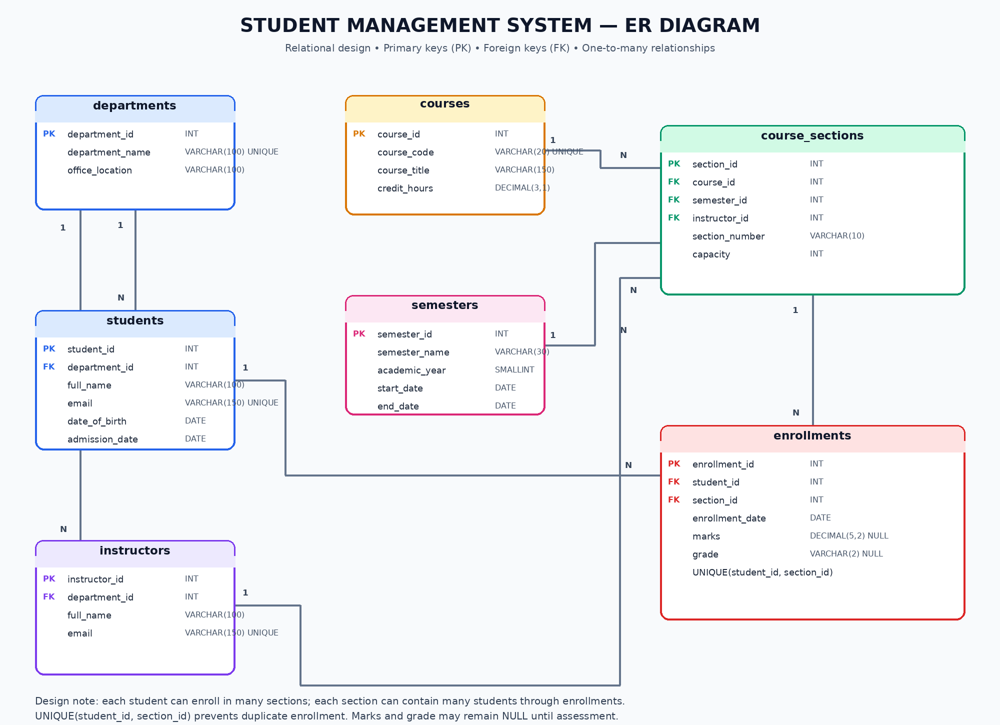

# Student Management System

A real-world database case study designed to demonstrate SQL problem-solving, relational database design, data integrity, academic reporting, transaction management, and database security using **MySQL / MariaDB**.

This project simulates a university's student management system, covering students, departments, instructors, courses, semesters, course sections, enrollments, and academic results.

## Project Objectives

- Design a structured relational database for a university.
- Implement relationships between students, departments, courses, and instructors.
- Solve real-world problems using SQL queries.
- Maintain data integrity using constraints and relationships.
- Generate academic reports using joins, aggregate functions, and views.
- Improve query performance using indexes and execution plans.
- Demonstrate transactions, triggers, stored procedures, and access control.
- Apply normalization principles and analyze functional dependencies.
- Explore hashing, table partitioning, and summary-table optimization.
- Validate database consistency through practical testing.

## Technologies Used

- **Database:** MySQL / MariaDB
- **Query Language:** SQL
- **Database Tool:** phpMyAdmin or MySQL-compatible client
- **Documentation:** Markdown
- **Diagram:** Entity–Relationship Diagram (ERD)

## SQL Files and Their Purposes

| File | Description |
|---|---|
| `01_schema.sql` | Creates the database schema, tables, keys, and relationships. |
| `02_sample_data.sql` | Inserts sample university records for testing and practice. |
| `03_solutions.sql` | Solves foundational SQL problems using the project database. |
| `04_views.sql` | Creates reusable views for student, enrollment, and academic reports. |
| `05_indexes.sql` | Demonstrates indexes, composite indexes, and query optimization. |
| `06_transactions.sql` | Demonstrates transactions, COMMIT, ROLLBACK, and SAVEPOINT. |
| `07_procedures_triggers.sql` | Implements stored procedures, automatic grading, and audit logging. |
| `08_security.sql` | Demonstrates database users, privileges, GRANT, and REVOKE. |
| `09_advanced_queries.sql` | Covers advanced SQL problems and academic performance analysis. |
| `10_hashing.sql` | Demonstrates SQL hashing functions and hash-based comparisons. |
| `11_partitioning.sql` | Explores table partitioning and partition-aware query plans. |
| `12_testing.sql` | Provides validation queries for records, views, indexes, and database objects. |
| `13_normalization.sql` | Demonstrates functional dependencies, 1NF, 2NF, 3NF, and practical table decomposition. |
| `14_summary_tables.sql` | Implements summary tables and stored-procedure-based refreshes as a materialized-view alternative. |
| `15_final_review.sql` | Provides final database structure, integrity, and consistency checks. |

## Entity–Relationship Diagram (ERD)

The ER diagram represents the relationships between the main entities in the Student Management System.

The database includes entities such as:

- **Students:** Student information and admission details.
- **Departments:** Academic department information.
- **Instructors:** Faculty and instructor records.
- **Courses:** Course codes, titles, and credit hours.
- **Semesters:** Academic terms and years.
- **Course Sections:** Course offerings assigned to instructors.
- **Enrollments:** Student registration and academic results.

## Real-World Problems Solved

This project demonstrates how SQL can answer practical university management questions:

- Find the top-performing students.
- Identify the highest-scoring student in each course.
- Compare student performance against department averages.
- Find students with pending results.
- Identify courses that have never been offered.
- Calculate section occupancy and available seats.
- Compare course performance across semesters.
- Generate student enrollment and academic summaries.
- Detect duplicate enrollments and inconsistent records.
- Audit changes to student results.
- Analyze enrollment patterns and academic performance.
- Validate database integrity and review query execution plans.

## How to Run the Project

1. Install or access MySQL / MariaDB through phpMyAdmin or another compatible client.
2. Open the SQL execution interface.
3. Execute `01_schema.sql` to create the database structure.
4. Execute `02_sample_data.sql` to insert the sample records.
5. Execute `03_solutions.sql` to explore the foundational SQL problems.
6. Run the remaining SQL files individually in numerical order.
7. Review query results and execution plans.
8. Verify the database objects and integrity checks using `12_testing.sql` and `15_final_review.sql`.
9. Review the ERD and documentation to understand the overall database design.

**Important:** Some scripts create database objects, modify sample data, or require administrative privileges. Review the statements before execution and use a development database for testing. Follow any file-specific execution instructions.

## Compatibility Notes

- The project targets MySQL / MariaDB; syntax and feature support can vary by server version.
- Some advanced queries require a version supporting common table expressions and window functions.
- Database account management requires appropriate privileges.
- MySQL does not provide native materialized views in the same way as some other database systems; summary tables and refresh procedures can be used as alternatives.
- Partitioning has engine-specific restrictions, including foreign-key limitations for partitioned InnoDB tables.
- Hashing demonstrations are for learning purposes. Plain SHA-256 is not suitable for storing user passwords.
- The grading scale used in examples is illustrative and should be adapted to the university's official grading policy.
- The normalization script uses separate demonstration tables; it does not automatically normalize the original database schema.
- Summary tables must be refreshed when their underlying data changes unless an automatic refresh mechanism is implemented.

## Learning Outcomes

By completing this case study, learners can practice:

- Designing relational database schemas.
- Writing SQL queries to solve practical problems.
- Applying database constraints and normalization principles.
- Understanding functional dependencies and relational decomposition.
- Creating meaningful reports and analytical queries.
- Managing transactions and database concurrency.
- Automating database tasks with triggers and stored procedures.
- Applying database permissions and security principles.
- Analyzing indexes, query plans, hashing, and partitioning.
- Building summary tables for reporting.
- Testing data integrity and validating database behavior.

## Project Status

An evolving SQL learning and database case study. The project brings together foundational SQL, relational database design, advanced querying, performance optimization, security, and validation through practical university management scenarios.
